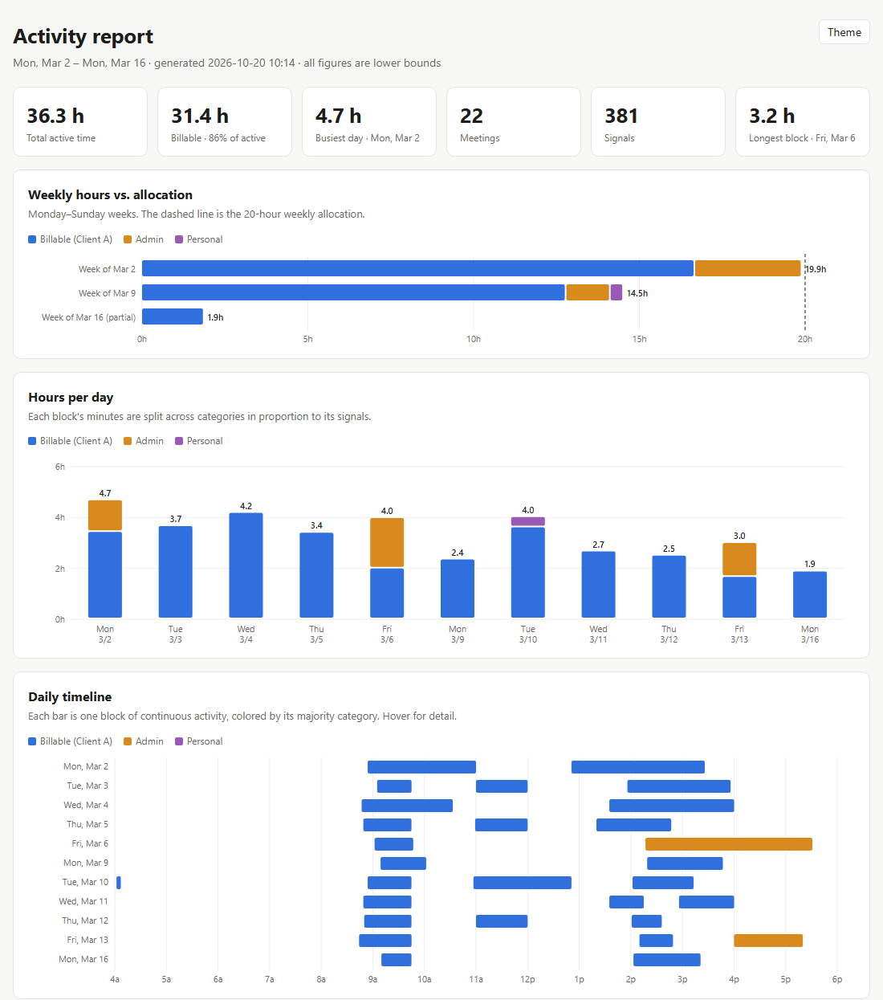

# Hoursleuth

**Rebuild your work timeline from the traces you already leave: sent messages, sent email, meetings, saved files and browser history. Then turn it into time blocks, billable hours and a report you can check.**

Forgot to log your hours? Need to show the effort behind a deliverable? Hoursleuth is a method, a set of prompts and a few small scripts that have [Claude Code](https://claude.com/claude-code) do the detective work: it reads your *own* activity through read-only connectors, merges it into blocks of continuous work, splits each block into billable, admin and personal time, and builds a single-file interactive report with a draft timesheet.



*Built from the fictional dataset in [examples/synthetic](examples/synthetic). [Download the full example report](examples/synthetic/activity_report.html) and open it in a browser.*

> **Everything it produces is a lower bound.** Thinking, reading and drafting that leave no digital trace aren't counted. Use it to recover hours you forgot and to back up your time, not to replace logging time as you go.

## What's here

| Path | What it is |
|---|---|
| [PLAYBOOK.md](PLAYBOOK.md) | The full method, step by step, with the pitfalls we hit and how to avoid them. Start here. |
| [RESPONSIBLE_USE.md](RESPONSIBLE_USE.md) | Who this is for, and the rules that keep it safe. Read before your first run. |
| [prompts/](prompts) | Copy-paste prompts: starting a run, exporting activity from another computer, building shareable versions. |
| [skills/hoursleuth/](skills/hoursleuth) | A Claude Code skill: instructions, PowerShell scripts, report template and example config. |
| [examples/synthetic/](examples/synthetic) | Two weeks of fictional data and every output built from it. |

## Quick start

You need Claude Code (desktop app or CLI) and, for the scripts, Windows with PowerShell 5.1 (built in). The method itself works anywhere; see [Prerequisites](PLAYBOOK.md#3-prerequisites).

**Option A: install the skill.** Clone the repo and copy the skill folder into your Claude Code skills folder:

```bash
git clone https://github.com/delimiterbob/hoursleuth.git
```

```powershell
Copy-Item -Recurse hoursleuth\skills\hoursleuth "$HOME\.claude\skills\hoursleuth"
```

Then open Claude Code in an empty folder and ask: *"Use the hoursleuth skill to rebuild my work activity since March 2."* Claude will ask for the rest (time zone, client, categories, allocation).

**Option B: just the prompt.** Open Claude Code in an empty folder, put a copy of [PLAYBOOK.md](PLAYBOOK.md) and the [skills/hoursleuth](skills/hoursleuth) folder in it, and paste [prompts/starter-prompt.md](prompts/starter-prompt.md) with the blanks filled in.

**Try the scripts on the example data** (no connectors needed):

```powershell
cd hoursleuth\skills\hoursleuth\scripts
.\build_blocks.ps1 -Dir ..\..\..\examples\synthetic -Browser ..\..\..\examples\synthetic\browser_visits.csv
.\build_report.ps1 -Dir ..\..\..\examples\synthetic
```

## How it works

1. **Collect** your own signals through read-only connectors: chat messages you sent, email you sent, meetings you accepted, files you saved. Optionally add browser history (from a copy) and Claude Code conversation logs from other computers.
2. **Normalize** everything into one `activity_events.csv`: `Start, End, Source, Detail`.
3. **Merge** signals into blocks: anything within 30 minutes on the same day is one block of work.
4. **Categorize** by vote: each signal votes billable, admin or personal using patterns you set; meetings count 10 votes; each block's minutes are split in proportion.
5. **Report**: one self-contained HTML file with weekly hours vs. allocation, a daily timeline, a heatmap, collaborators, a draft timesheet with copy buttons, and every block's evidence.

The details, and why each rule exists, are in the [playbook](PLAYBOOK.md).

## Privacy in one paragraph

Connectors are used **read-only**. Only *your* activity is collected. Browser history is read from a copy in a temp folder, keeping only the time, site and page title. The full report stays on your machine because it contains message labels, file names and colleagues' names; for anyone else, build a [stripped-down variant](PLAYBOOK.md#16-shareable-variants). Check your employer's policy on connecting work accounts to AI tools before you start. More in [RESPONSIBLE_USE.md](RESPONSIBLE_USE.md).

## Contributing

Issues and pull requests are welcome. Especially wanted:

- A Python port of the scripts for macOS and Linux
- Firefox history support
- Shareable report variants (finance, manager, client)
- Connectors and query recipes for other tools (Microsoft 365, Teams, Outlook, Jira)

Never include real activity data in an issue or pull request. Use the fictional style in [examples/synthetic](examples/synthetic).

## License

Code (scripts, template): [MIT](LICENSE). Documentation and prompts: [CC BY 4.0](LICENSE-docs).
